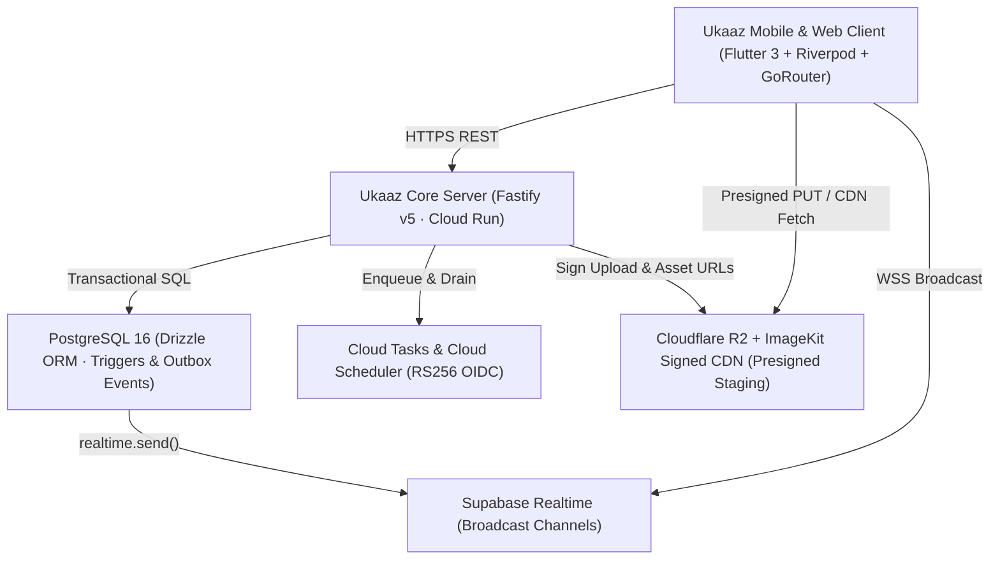

# 🛍️ Ukaaz | عکاظ

### AI-Powered Auction & E-Commerce Marketplace
**UIT University · Final Year Project (FYP 2026–2027) · Group 11**

  A modern, high-throughput commerce ecosystem engineered specifically for Pakistani online commerce. 
  Combining fixed-price storefronts with live proxy auctions, dual-tier merchant governance, and escrow settlement.

---

## 📌 About Ukaaz

Traditional e-commerce in emerging markets often faces low buyer trust, non-serious bidding, and counterparty delivery defaults. **Ukaaz** (inspired by the historical *Souq Ukaz*) modernizes market trading by providing:

* ⏱️ **Unified Buy-Now & Live Auctions**: Pessimistic row-locked proxy bidding (`SELECT ... FOR UPDATE`), seller-configurable anti-sniping extensions, in-transaction Supabase Realtime `Broadcast`, and Cloud Tasks / Cloud Scheduler OIDC settlement.
* 🏪 **Dual-Tier Merchants & Governance**: Single master identity supporting both **Personal Sellers** and multi-member **Store Merchants** (`owner` / `admin` / `staff` RBAC) with immutable role audit logs.
* 📦 **Inventory Ledger & Dynamic Attributes**: Trigger-backed `inventory_ledger` stock tracking, `ltree` category taxonomy, extensible JSONB attributes, and generalized listing-level `listing_media`.
* 🛡️ **Escrow Transaction Settlement** *(Roadmap)*: Structured double-entry buyer protection holding funds until milestone delivery verification.

---

## 🏛️ Ecosystem Architecture

---

## 📂 Active Repositories

| Repository | Scope & Description | Tech Stack |
| :--- | :--- | :--- |
| [**`ukaaz-server`**](https://github.com/ukaaz/ukaaz-server) | Modular monolith backend API with OpenAPI 3.1/Zod v4 contracts, live auction engine, transactional outbox, and R2/ImageKit media pipeline. | Fastify v5, TypeScript, Drizzle ORM, Zod v4, Better Auth, PostgreSQL 16, Cloud Tasks, Sentry |
| [**`ukaaz-mobile`**](https://github.com/ukaaz/ukaaz-mobile) | Cross-platform Android & Web client with Material 3 *Tactile Heritage* UI, unified listing/auction publishing, and live auction WebSockets. | Flutter 3, Dart 3, Riverpod, GoRouter, Retrofit/Dio, `dart_mappable`, `realtime_client`, Sentry |
| [**`ukaaz-docs`**](https://github.com/ukaaz/ukaaz-docs) | Cross-repository architecture, technical contract (`CONTRACT.md`), DDD glossary, ADRs, roadmap, and FYP reports. | Markdown, Mermaid, ADRs |

---

## 👥 FYP Group 11 Roster

| Name | Role | Responsibilities |
| :--- | :--- | :--- |
| **Sahir Ul Hassan** | Project Lead / System Architect | Overall system architecture, database schema, core plugins, PR reviews, CI/CD pipelines |
| **Javaria Owais** | Full-Stack Developer | Feature module implementation, business services, integration testing |
| **Kainat Bintay Faisal** | Full-Stack Developer | Feature module implementation, API routes, schema validation |
| **Zunaira Manzoor** | Full-Stack Developer | Feature module implementation, mobile integration, documentation |

---

## 📋 Engineering Standards

All repositories under the `ukaaz` organization follow strict development practices:
* **Conventional Commits**: `feat:`, `fix:`, `refactor:`, `chore:`, `docs:` commit messages.
* **Feature Branching**: Branches originate from `main` using `feature/<module>`, `fix/<ticket>`, or `docs/<topic>`.
* **Automated Quality Checks**: Formatting, typechecks, and tests (Biome + `tsc` + `tsx --test` on server; `dart fix --apply` + `flutter analyze` + `flutter test` on mobile) must pass on every change.

For detailed guidelines, please refer to our [Contributing Guide](https://github.com/ukaaz/.github/blob/main/CONTRIBUTING.md).
